# Plan de Entrenamiento de 3 Días: Dominio Absoluto (15 Minutos)

Este plan de entrenamiento está diseñado específicamente para que domines la presentación de tu Trabajo de Título: **"Metodología basada en procesamiento de lenguaje natural para analizar la alineación curricular de Ingeniería Informática en Chile con estándares ACM/IEEE y necesidades de la industria"**.

---

## 📊 Estructura de Tiempos Recomendada (Total: 15 Minutos)

Para no quedarte sin tiempo en las diapositivas finales (Metodología y Plan de Trabajo), debes seguir este ritmo estricto. **¡No te quedes pegado en el contexto!**

| Bloque | Diapositivas | Contenido | Tiempo Objetivo | Minuto de Control |
| :--- | :--- | :--- | :--- | :--- |
| **Introducción** | 1 - 3 | Portada y Tabla de Contenidos | **1:00 min** | Al minuto 1:00 |
| **Contexto e Identificación** | 4 - 7 | Contexto Chile, ACM/IEEE y Motivación | **2:30 min** | Al minuto 3:30 |
| **El Problema** | 8 - 10 | Solución, Literatura y Enunciado del Problema | **2:00 min** | Al minuto 5:30 |
| **Objetivos y Métricas** | 11 - 12 | Objetivo General y los 5 Objetivos Específicos | **3:30 min** | Al minuto 9:00 |
| **Metodología y Datos** | 13 - 14 | Enfoque (CRISP-DM) y Corpus/Modelamiento | **2:30 min** | Al minuto 11:30 |
| **Entorno y Cierre** | 15 - 17 | Software/Hardware, Plan de Trabajo y Cierre | **2:00 min** | Al minuto 13:30 |
| **Colchón de Seguridad** | - | Flexibilidad para pausas o énfasis | **1:30 min** | Al minuto 15:00 |

---

## 🗓️ Cronograma Diario de Entrenamiento

```mermaid
gantt
    title Plan de Entrenamiento - 3 Días
    dateFormat  X
    axisFormat %d
    
    section Día 1: Estructura y Guion
    Dominio de la Diapositiva 12 (Métricas)  :active, d1_1, 0, 4
    Definición de Conectores entre Diapositivas :d1_2, after d1_1, 4h
    Lectura de Guion en Voz Alta (x3)       :d1_3, after d1_2, 4h
    
    section Día 2: Control de Tiempos
    Establecer Checkpoints Fijos           :active, d2_1, 12, 16
    Simulaciones de 15 Minutos (Con Cronómetro) :d2_2, after d2_1, 4h
    Grabación y Corrección de Muletillas   :d2_3, after d2_2, 4h
    
    section Día 3: Defensa y Q&A
    Simulación de Preguntas del Comité (USACH) :active, d3_1, 24, 28
    Práctica con Espejo / Lenguaje Corporal  :d3_2, after d3_1, 4h
    Ensayo General con Ropa de Presentación :d3_3, after d3_2, 4h
```

---

### 🟢 DÍA 1: Estructura, Conceptos Clave y Guionización
**Objetivo:** Dominar el "qué decir" de cada diapositiva y conectar las ideas fluidamente sin leer el texto de la pantalla.

#### 1. Memorizar el Núcleo Técnico (La Diapositiva 12)
La diapositiva 12 es la más importante de tu presentación. Muestra tus Objetivos Específicos (OE) y los criterios de calidad. Debes explicar cada uno con propiedad matemática y computacional:
*   **OE1 (Corpus):** Muestra por qué el preprocesamiento NLP (limpieza de términos ruidosos como "cátedra", "laboratorio") evita el efecto *Garbage In, Garbage Out*. Tu criterio es **Datos nulos < 1%**.
*   **OE2 (Vectorización):** Habla de la reducción dimensional de embeddings SBERT a 2D con UMAP. Explica que el **Trustworthiness ≥ 0.85** garantiza que la estructura vecinal del espacio de alta dimensión se conserva en 2D, evitando distorsiones visuales.
*   **OE3 (Clustering):** Justifica el uso de la tríada (K-Means para perfiles, Jerárquico para parentesco entre universidades, DBSCAN para aislar outliers). Explica que exiges **Silhouette ≥ 0.25** y **Davies-Bouldin < 1.50** para probar que los clústeres tienen separación real y no son ruido.
*   **OE4 (Validación Híbrida):** Este es tu escudo ante el jurado. Combina métricas duras (estabilidad de clusters vía **Bootstrap con ARI ≥ 0.75**) con evaluación de expertos (mide el acuerdo usando **Kappa de Fleiss/Cohen ≥ 0.60**).
*   **OE5 (Dashboard):** El entregable práctico en React. La **latencia < 2.0 s** garantiza usabilidad real para directores de carrera.

#### 2. Diseñar los "Ganchos de Transición"
Evita decir *"y en la siguiente diapositiva vemos..."*. Usa conectores lógicos:
*   **De Diapositiva 5 (Brecha) a 6 (ACM):** *"Para medir esta brecha con rigor, necesitamos un marco de comparación estandarizado. Por ello, recurrimos a..."*
*   **De Diapositiva 7 (Motivación) a 8 (Propósito):** *"Frente a estos problemas de subjetividad y alto costo, nuestra propuesta plantea..."*
*   **De Diapositiva 10 (Pregunta) a 11 (Objetivo General):** *"Para responder formalmente a esta pregunta de investigación, nos planteamos el siguiente objetivo general..."*

#### 3. Entrenamientos del Día 1
*   **Ejercicio 1 (Lectura de Apoyo):** Lee las notas de orador que tienes integradas en la presentación. Hazlo 3 veces pausadamente para familiarizarte con las palabras clave.
*   **Ejercicio 2 (El Mapa Mental):** Di en voz alta de qué trata cada slide usando solo 3 palabras. Ejemplo: *Slide 7: "Sesgo, costos, desconexión"*.

---

### 🟡 DÍA 2: Ritmo, Control de Tiempos y Eliminación de Muletillas
**Objetivo:** Ajustar tu velocidad de habla para entrar exactamente en el rango de **13:30 a 14:30 minutos**, dejando un margen de seguridad.

> [!IMPORTANT]
> En la USACH, pasarse del tiempo asignado (15 minutos) suele ser penalizado por la comisión evaluadora, interrumpiendo tu presentación o bajando tu nota de defensa.

#### 1. Implementar Checkpoints de Control
Durante tu presentación, mira discretamente el reloj en estos hitos clave:
1.  **Minuto 3:30:** Debes estar terminando la Diapositiva 7 (Motivación). Si vas en la 5, acelera. Si vas en la 9, baja un cambio.
2.  **Minuto 5:30:** Debes terminar de leer la pregunta de investigación (Diapositiva 10).
3.  **Minuto 9:00:** Debes terminar de explicar los Criterios de Calidad de los Objetivos Específicos (Diapositiva 12).
4.  **Minuto 11:30:** Debes cerrar la sección metodológica y el corpus (Diapositivas 13 y 14).
5.  **Minuto 13:30:** Debes terminar las conclusiones o el Plan de Trabajo (Diapositiva 16) y pasar al cierre.

#### 2. Entrenamientos del Día 2
*   **Ejercicio 1 (Simulación Grabada):** Grábate en audio utilizando el celular mientras expones frente al computador. No te detengas si te equivocas; continúa hasta el final.
*   **Ejercicio 2 (Auditoría de Audio):** Escucha tu grabación y anota en un papel cuántas veces dices muletillas como *"ehh"*, *"ya"*, *"bueno"*, *"o sea"*, o *"digamos"*. Reemplaza estas muletillas por **silencios de 1 segundo**. El silencio genera suspenso y proyecta seguridad académica.
*   **Ejercicio 3 (Simulación de Velocidad):** Haz una presentación súper rápida (en 10 minutos) y otra súper lenta (en 18 minutos). Esto te dará control consciente sobre tu velocidad de habla.

---

### 🔴 DÍA 3: Defensa de Tesis, Preguntas Difíciles y Postura
**Objetivo:** Prepararte para la ronda de preguntas (Q&A) de la comisión y pulir tu lenguaje corporal.

#### 1. Simulador de Preguntas del Jurado (USACH)
Los profesores de la USACH se enfocarán en la validez científica y el aporte de tu tesis. Prepárate para responder estas preguntas:

| Posible Pregunta del Jurado | Respuesta Estratégica (Tu Defensa) |
| :--- | :--- |
| **"¿Por qué usas Sentence-Transformers (SBERT) multilingüe en vez de traducir las mallas al inglés?"** | *"La traducción automática introduce ruido semántico y sesgos, especialmente en términos técnicos locales. SBERT multilingüe (como `multilingual-e5-large`) proyecta textos en español e inglés en un mismo espacio vectorial de forma nativa, preservando la equivalencia conceptual sin depender de traductores."* |
| **"Un Silhouette de 0.25 es bajo. ¿Cómo justifica la validez de los clústeres formados?"** | *"En clustering de texto de alta dimensión (descripciones curriculares), la variabilidad lingüística es muy alta, por lo que valores entre 0.25 y 0.50 son estándar y reflejan una estructura de datos real. Además, este valor se complementa y valida cualitativamente con el juicio del panel de expertos."* |
| **"¿Cómo determinaron el tamaño de la muestra de expertos y cómo garantizaron la objetividad de su validación?"** | *"Seleccionamos un panel de 3 expertos independientes (docentes del área TI). La objetividad del acuerdo se evaluó estadísticamente mediante el Índice Kappa. Un valor superior a 0.60 demuestra un acuerdo sustancial, reduciendo el sesgo individual de los evaluadores."* |
| **"¿Qué pasa si UMAP arroja un Trustworthiness menor a 0.85?"** | *"Significaría que la visualización 2D en el Dashboard está distorsionando las distancias conceptuales reales. En ese caso, se recalibran los hiperparámetros de UMAP (como `n_neighbors` o `min_dist`) o se aumenta la dimensionalidad de salida en la proyección previa."* |

#### 2. Entrenamientos del Día 3
*   **Ejercicio 1 (Ensayo Físico de Pie):** Expón de pie. Utiliza tus manos para enfatizar los puntos clave (por ejemplo, enumera con los dedos los 5 objetivos específicos de la Diapositiva 12).
*   **Ejercicio 2 (El Ensayo Espejo):** Expón mirándote a un espejo o grábate en video. Observa tu postura: mantén los hombros relajados y evita balancear el cuerpo de un lado al otro (esto denota nerviosismo).
*   **Ejercicio 3 (Ensayo General):** Haz una última simulación completa vestido con la ropa formal que usarás el día de la presentación. Esto te ayudará a sentirte cómodo y seguro en la situación real.

---

## 💡 Consejos de Último Minuto
> [!TIP]
> *   **El Inicio es Clave:** Empieza con voz firme. Las dos primeras frases deben estar memorizadas al 100% para disipar los nervios iniciales.
> *   **Control de la Respiración:** Antes de empezar, realiza 3 respiraciones profundas (diafragmáticas). Esto regula tu ritmo cardíaco de forma biológica.
> *   **Usa el "Puntero Láser Virtual":** Si la presentación es online o con proyector, usa el puntero para guiar la vista del jurado en el mapa semántico y los gráficos de la diapositiva 12 y 13.
